# Project 05 – Microsoft Entra Conditional Access

## Project Overview

This project demonstrates the design, implementation, testing and troubleshooting of **Microsoft Entra Conditional Access** policies in the fictional **Bright Horizons Health** tenant.

The lab progressed from a small MFA pilot to organisation-wide MFA, application-specific access blocking, legacy authentication restrictions and country-based access controls. Policies were assessed through **Report-only mode, What If simulations, actual sign-ins and Microsoft Entra sign-in logs**.

The central objective was to understand not only *how to configure a policy*, but also **why a policy applies, how multiple policies interact, and how to prove the resulting access decision**.

---

# Business Scenario

Bright Horizons Health needs to protect staff access to Microsoft 365 and other cloud applications while avoiding unnecessary disruption to clinical and reception operations.

The organisation wants to:

- Introduce MFA through a controlled pilot before wider deployment.
- Establish a consistent MFA requirement for employees.
- Restrict access to a sensitive test application for selected users.
- Reduce exposure to legacy authentication clients.
- Evaluate geographic restrictions for sign-ins from a designated country.
- Preserve emergency administrative access if normal authentication becomes unavailable.
- Validate access decisions using evidence rather than relying on configuration screenshots alone.

---

# Project Objectives

- Understand Conditional Access assignments, conditions, grant controls and policy states.
- Build and test a security-group-based MFA pilot.
- Extend MFA to all users with an emergency-access exclusion.
- Compare Report-only evaluation with enforced sign-in behaviour.
- Validate application-specific blocking and out-of-scope access.
- Configure a policy blocking legacy authentication client types.
- Configure a country-based named location and test geographic matching.
- Interpret Conditional Access and Authentication Details in sign-in logs.
- Investigate unexpected results caused by VPN IP geolocation.
- Understand policy overlap, exclusions, blocking precedence and operational deployment risk.

---

# Environment

| Component | Configuration |
|---|---|
| Organisation | Bright Horizons Health (fictional) |
| Identity platform | Microsoft Entra ID, cloud-only tenant |
| Administration | Microsoft Entra admin center |
| Policy feature | Conditional Access (Entra ID P1 entitlement through Microsoft 365 Business Premium trial during implementation) |
| Pilot security group | `SG-CA-MFA-Pilot` |
| Pilot population | Five clinical and reception users |
| Application used for testing | `BHH-CA-Test-App` (SAML test enterprise application) |
| MFA and sign-in testing | Emily Nguyen, Ethan Hall and administrator test account |
| Location-based test user | Ethan Hall |
| Named location | `NL-Restricted-Germany` |
| Validation methods | Report-only, What If, interactive sign-ins, Conditional Access sign-in logs |

---

# Conditional Access Design

Conditional Access evaluates **who** is signing in, **what resource** they are accessing and **which conditions** apply. When a policy matches, its grant and session controls determine additional requirements or blocking.

**Matching a policy's conditions is different from satisfying its grant controls.** An enforced `Block access` policy that matches a sign-in denies access even when another policy's MFA requirement is satisfied.

### Transition from Security Defaults to Conditional Access

Before implementing custom Conditional Access policies, **Security Defaults were disabled** to allow granular policy management within the Bright Horizons Health tenant.

Custom policies were then configured to enforce MFA, block legacy authentication and restrict access under selected conditions.

During the transition, Microsoft-managed Conditional Access policies were also present in the tenant. These were reviewed and switched Off for the lab to avoid overlapping enforcement with the custom policies being tested.

**Key considerations:**

- Security Defaults provide Microsoft's predefined baseline identity protections, while Conditional Access allows more granular control over access requirements.
- Disabling Security Defaults should be accompanied by a carefully planned replacement security baseline.
- Microsoft-managed Conditional Access policies should be reviewed before being disabled or replaced.
- Emergency administrative access must remain protected and recoverable throughout the transition.

**Production consideration:** This was a controlled lab exercise. In a production environment, transitioning from Security Defaults to custom Conditional Access would require a documented policy design, impact assessment, staged deployment and validation to prevent unintended security gaps or administrative lockouts.

## Policy Inventory

| Policy | Scope | Control | Outcome / lab state |
|---|---|---|---|
| `CA001-Require-MFA-Pilot` | `SG-CA-MFA-Pilot`, Office 365 | Require MFA | Enforced; validated |
| `CA002-Require-MFA-All-Users` | All users and resources, excluding emergency administrator | Require MFA | Enforced; validated |
| `CA003-Block-Test-App-Pilot` | Pilot users, `BHH-CA-Test-App` | Block access | Enforced and validated, subsequently switched Off |
| `CA004-Block-Legacy-Authentication` | All users except emergency administrator; legacy client app types | Block access | Enabled; no matching legacy traffic observed |
| `CA005-Block-Germany-Ethan` | Ethan Hall, all resources, Germany named location | Block access | What If validated; temporary US-based enforcement test completed; restored to Report-only |

The tenant also contained Microsoft-managed Conditional Access policies. These were reviewed and switched Off during this lab to avoid overlapping with the user-created policies. This was a **lab-specific decision**, not a blanket recommendation for production environments.

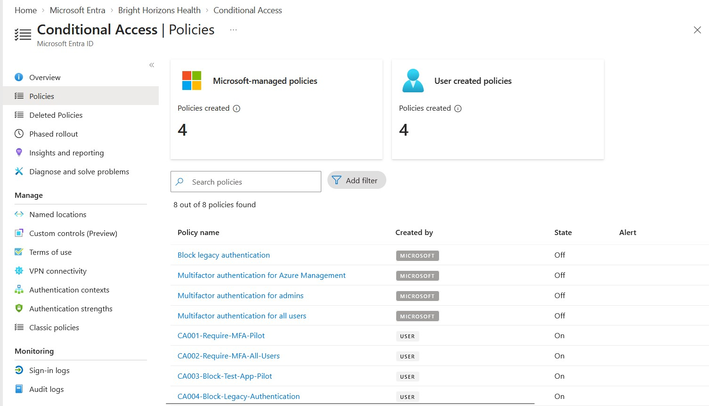

---

# Module 1 – Pilot MFA (CA001)

A security group, **`SG-CA-MFA-Pilot`**, was used to limit the initial rollout to five clinical and reception workers. This allowed the MFA experience and policy evaluation to be reviewed before extending coverage.

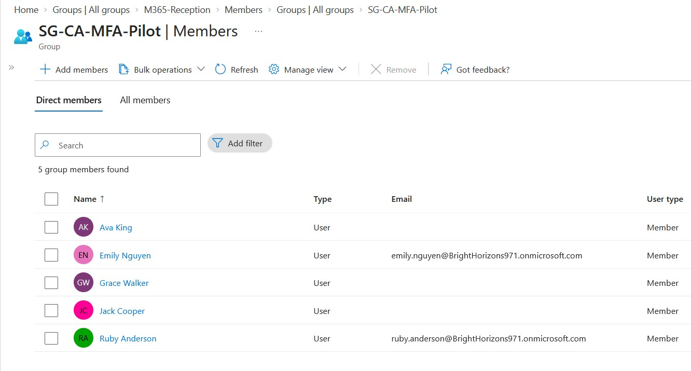

`CA001-Require-MFA-Pilot` targeted that group and Office 365 resources, with **Require multifactor authentication** as its grant control.

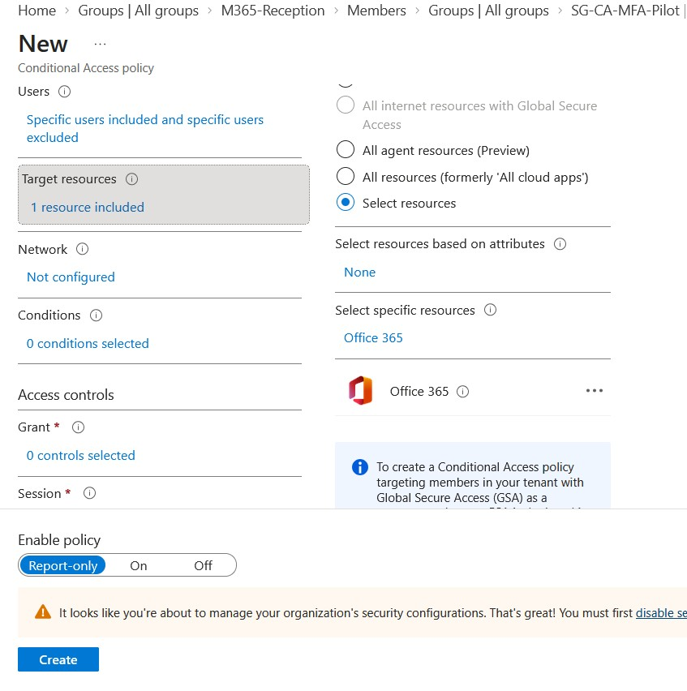

The policy was first evaluated in **Report-only mode**. Sign-in logs were then used to examine whether the policy matched and whether the authentication requirement had been satisfied. Following validation, MFA enforcement was tested on pilot users.

**Finding:** Report-only evaluates what a policy would do; it does **not** itself require a user to complete an additional MFA challenge.

---

# Module 2 – Organisation-Wide MFA (CA002)

`CA002-Require-MFA-All-Users` expanded the MFA baseline to all users and all resources, with an emergency administrator excluded to reduce tenant lockout risk.

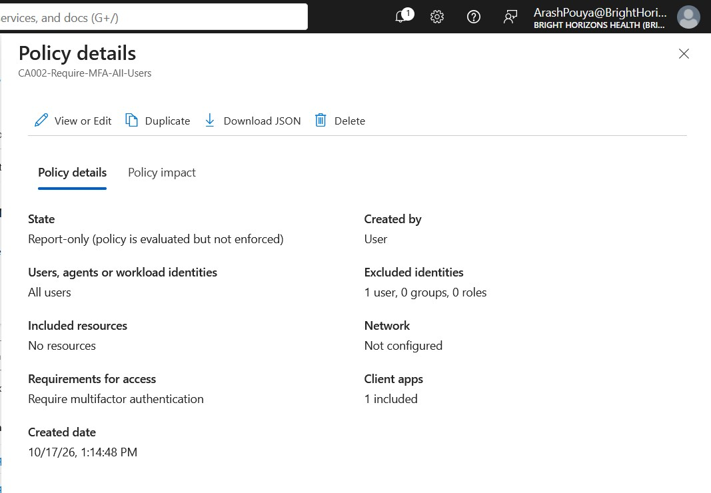

The enforced policy was validated through sign-ins, including a non-pilot test user, **Ethan Hall**. For Emily Nguyen, the sign-in log showed **both CA001 and CA002 applied successfully**—an important example of overlapping policies.

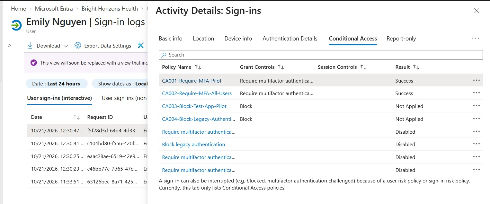

Authentication Details also showed that MFA could be **previously satisfied by a claim in the token**, rather than producing a new authenticator prompt for every application access.

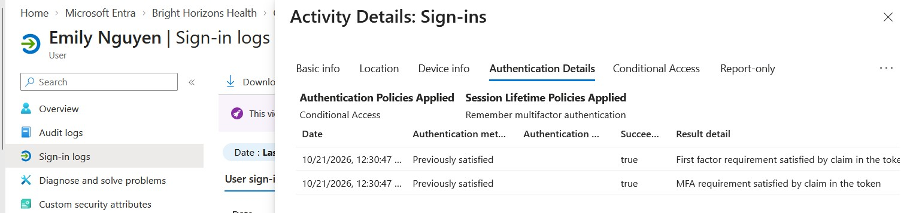

**Finding:** An MFA policy marked `Success` does not necessarily mean the user just received a fresh MFA prompt.

---

# Module 3 – Application-Based Blocking (CA003)

A SAML enterprise application, **`BHH-CA-Test-App`**, was used as a controlled access target. `CA003-Block-Test-App-Pilot` was scoped to this application and the MFA pilot group, using **Block access**.

The policy was evaluated in Report-only mode before enforcement. The enforced tests established two different outcomes:

| Test user | Expected behaviour | Observed result |
|---|---|---|
| Emily Nguyen (in pilot group) | Block access to test application | Denied; `AADSTS53003`; CA003 evaluated as Failure |
| Administrator test user (outside pilot group) | CA003 should not apply | Application access succeeded; CA003 Not Applied |

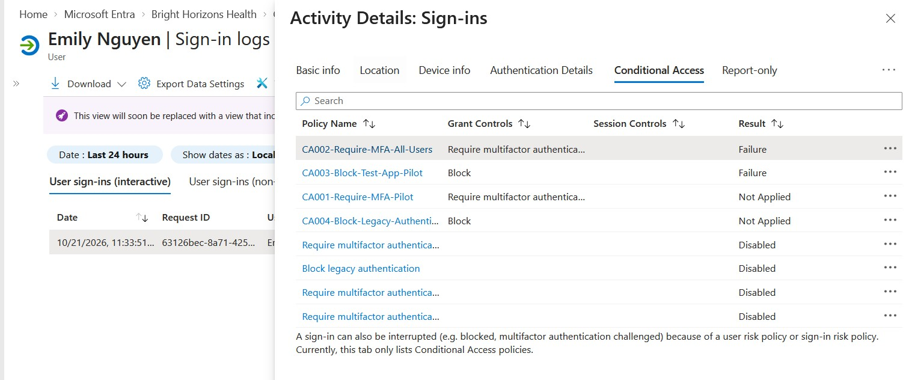

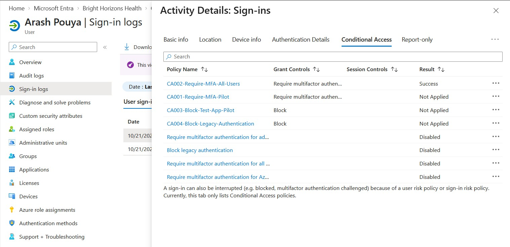

This demonstrated the distinction between a policy **actively denying access** and a policy **not applying** because the user is outside its scope. CA003 was subsequently switched **Off** to isolate later location-based tests.

---

# Module 4 – Legacy Authentication Blocking (CA004)

`CA004-Block-Legacy-Authentication` was configured to block legacy authentication client types, including **Exchange ActiveSync clients** and **Other clients**, across resources for the selected user scope.

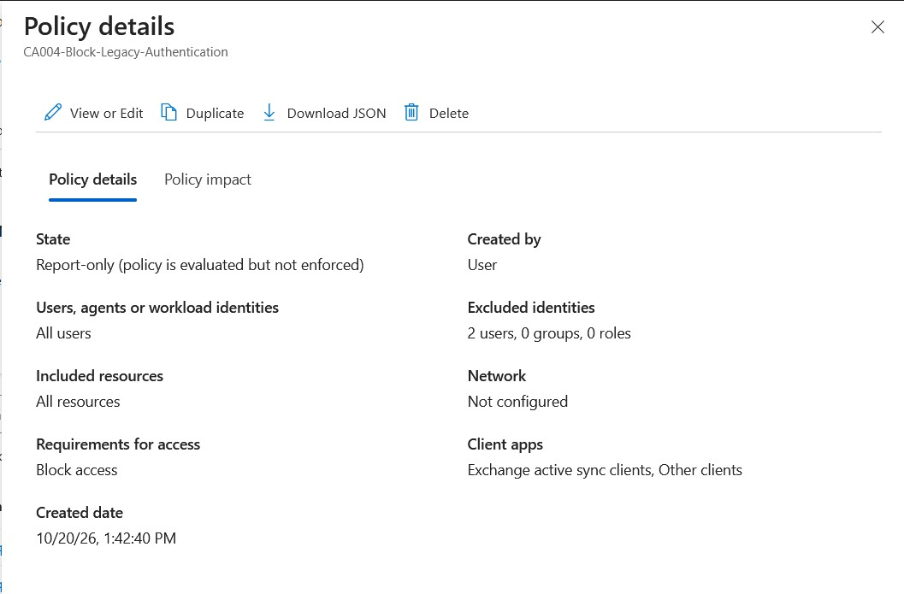

Sign-in activity was reviewed for legacy authentication attempts. **No matching legacy traffic was identified** in this cloud-only lab, so this module validates configuration and monitoring, **not a real blocked legacy-client sign-in**.

This distinction is relevant when presenting evidence: the absence of observed legacy connections is not proof that a blocking event was tested.

---

# Module 5 – Country-Based Blocking (CA005)

A named location, **`NL-Restricted-Germany`**, was created using the Germany country selection. `CA005-Block-Germany-Ethan` targeted **Ethan Hall**, all resources and that named location, with **Block access**.

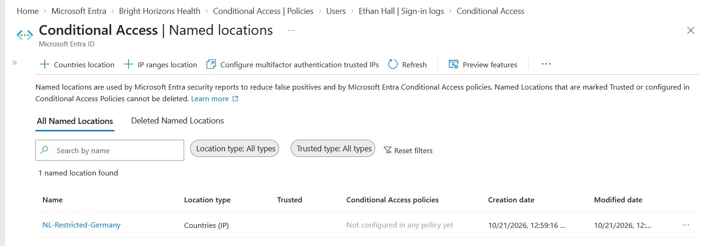

## What If Validation

The What If tool was used to simulate identical sign-in conditions except for the source location.

| Simulation | Policy result | Interpretation |
|---|---|---|
| Australian-geolocated IP | CA005 Not Applied — Location | Sign-in did not match the named location |
| German-geolocated IP | CA005 listed under policies that will apply, with Block access | Sign-in matched the location restriction |

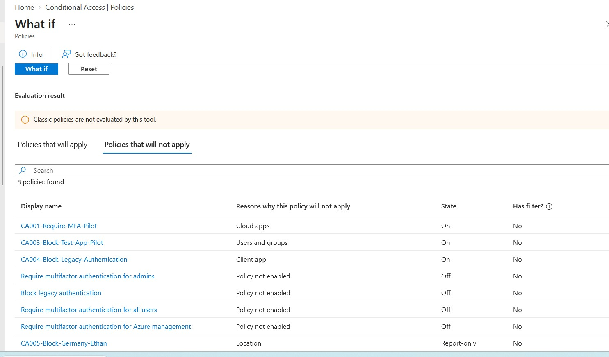

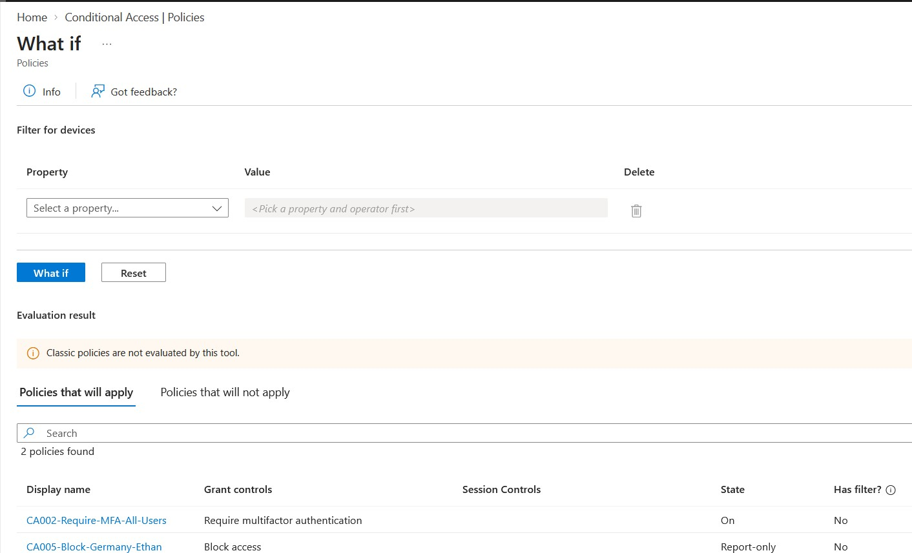

## Real Enforcement and Troubleshooting

An additional real sign-in test was performed using a browser VPN. Although the VPN interface was set to **Germany**, Microsoft Entra initially classified Ethan's connection as **Montgomery, Alabama, United States**. CA005 did not apply when Germany was its only included country, and Ethan signed in successfully.

To test actual enforcement under controlled conditions, **United States was temporarily added** to the named location while CA005 was enabled and still scoped only to Ethan. A subsequent Azure Portal sign-in was blocked with **`AADSTS53003`**. The Entra sign-in log recorded CA005 with **Result: Failure** and the Block grant control.

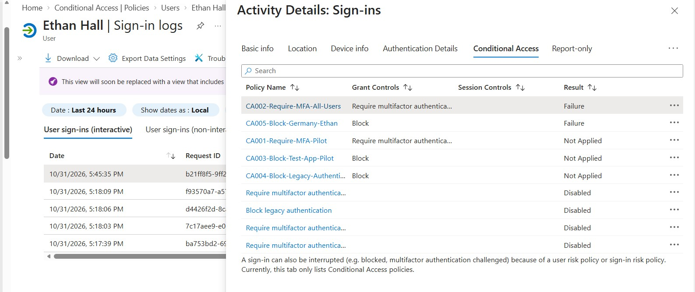

A further VPN test with **Japan** selected was also classified by Entra as originating from **San Francisco, United States**, and was blocked while the temporary US restriction remained in place.

**Important evidence boundary:** Germany was validated with **What If**, but the actual enforced block was demonstrated using a **temporarily included United States location**. The lab did not establish a successful real-world German-egress test.

After testing, the location was restored to **Germany only**, and CA005 returned to **Report-only mode**.

---

# Validation Summary

| Area | Validation evidence | Result |
|---|---|---|
| CA001 | Pilot group, Office 365 scoping and sign-in evaluation | Validated; enforced |
| CA002 | Real sign-ins and MFA policy outcomes | Validated; enforced |
| CA003 | Included user denied; excluded/out-of-scope user allowed | Validated through actual enforcement |
| CA004 | Policy configuration and sign-in review | Enabled; no legacy client traffic available to test blocking |
| CA005 | Australia/Germany What If; temporary US location enforcement | Simulation and real blocking behaviour validated |
| Emergency access | Emergency administrator access tested separately | Available during lab validation |

The project used **sign-in logs** as the primary means to confirm applicability and outcomes, rather than treating a saved policy configuration as proof of successful enforcement.

---

# Key Concepts and Lessons Learned

## Policy Exclusions Do Not Block Access

One particularly important design question was whether *requiring MFA outside Germany while excluding Germany* would prevent access from Germany. It would **not**: the policy would simply not apply to sign-ins from Germany.

| Business requirement | Appropriate design |
|---|---|
| Block sign-ins from Germany | **Block access** + include Germany |
| Block access everywhere except Australia | **Block access** + include any location + exclude Australia |
| Require MFA outside Australia | **Require MFA** + include any location + exclude Australia |

**An exclusion means that a policy does not apply; it is not a denial of access.** Conversely, a sign-in not blocked by one policy is not automatically authorised to access the resource—other applicable policies and application permissions still matter.

## Applicable Blocking Policies Take Precedence

When multiple Conditional Access policies apply, their requirements are evaluated together. **An applicable enforced Block access policy denies access even if another policy's MFA or device-compliance requirements are met.**

## Authentication Is Not Resource Authorisation

Successfully authenticating and completing MFA does not grant membership or permission to a particular SharePoint site, application or document. Resource-level access must be managed and validated separately.

## Real Source Location Matters More Than VPN Selection

Country-based Conditional Access depends on **the source IP and the location classification used by Entra**. During this lab, VPN selections for Germany and Japan were recorded as United States locations. Sign-in logs explained the otherwise unexpected policy decisions.

## Distinguish Policy Evaluation From Enforcement

Report-only and What If are valuable for deployment planning and negative/positive testing, but real sign-in evidence is needed to demonstrate actual enforcement. A blocked sign-in showing **AADSTS53003** and the corresponding policy result provides stronger evidence.

---

# Production Considerations

- **Stage changes carefully:** Begin with a limited pilot and Report-only evaluation; examine impact before wider enforcement.
- **Protect emergency access:** Maintain separately secured, tested emergency accounts and avoid lockout through unsuitable policy assignments or exclusions.
- **Review overlapping policies:** Multiple policies can apply to one sign-in; avoid assuming one successful MFA control explains the entire access decision.
- **Assess session controls:** Sign-in frequency and browser-session configuration can affect repeated authentication prompts without indicating an MFA policy fault.
- **Check country/IP assumptions:** VPN exit locations, IP geolocation and changing network paths can affect geographic restrictions; avoid treating country restrictions as the sole access safeguard.
- **Avoid unnecessary exclusions:** A user exclusion removes that policy's protection for the excluded identity. Exceptions need business justification, review and alternative safeguards.
- **Separate configuration from evidence:** Record when controls were actually enforced, merely simulated or not tested because suitable traffic was unavailable.
- **Confirm licensing:** Conditional Access requires appropriate Microsoft Entra licensing for users benefiting from the feature.

---

# Conclusion

This project implemented and evaluated five Conditional Access policies covering **pilot MFA, organisation-wide MFA, application access blocking, legacy authentication and geographic restrictions**.

The strongest practical outcomes were validation of overlapping MFA policies, observed application blocking with a contrasting permitted sign-in, and troubleshooting a location policy whose initial real-world result differed from the What If simulation. The final sign-in evidence demonstrated that **Entra's detected network location—not the VPN interface selection—determined whether the country-based policy applied**.

These exercises strengthened practical skills in **identity security, policy scoping, least privilege, safe rollout, sign-in troubleshooting and evidence-based validation** relevant to Microsoft 365 administration, Systems Administration and IAM roles.

---

# Next Steps

Continue the Microsoft Entra and Intune lab roadmap, including further authentication-method security, endpoint compliance and production-style Conditional Access policy design. More advanced production exercises will examine **Microsoft-managed policies, policy overlap, emergency-access architecture and controlled change management**.
